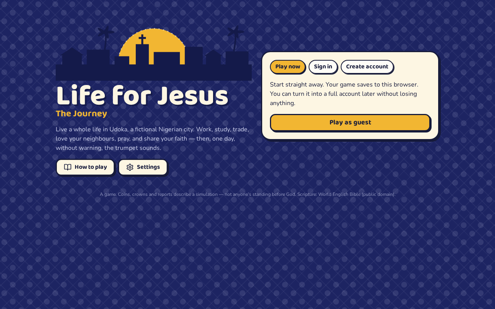
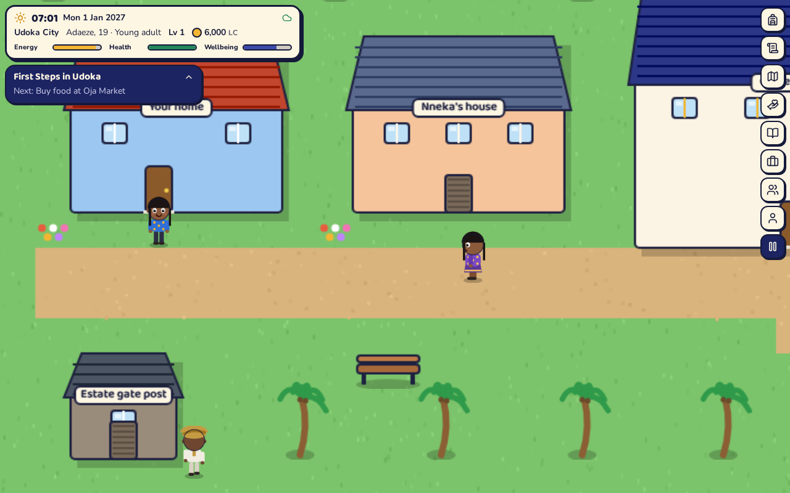
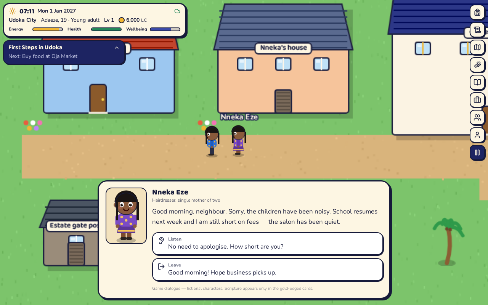
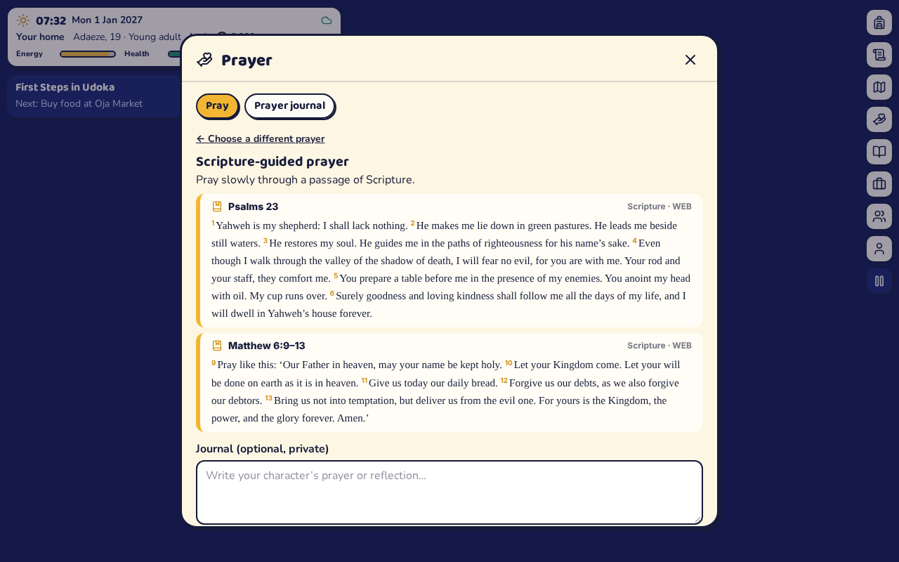
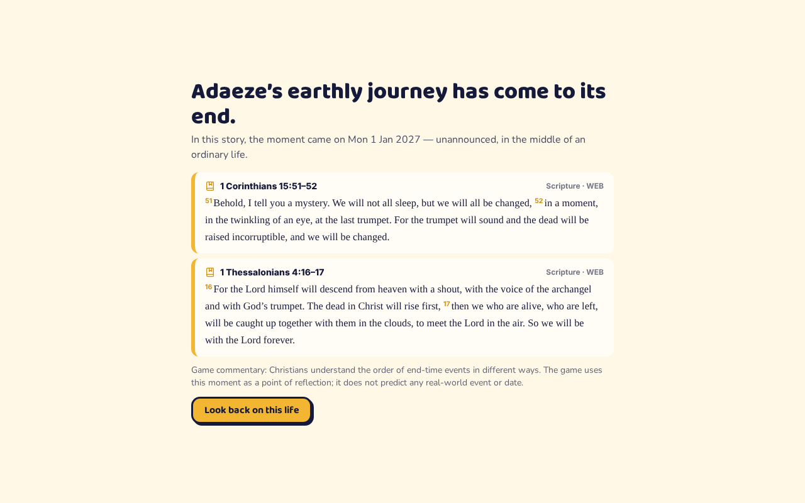
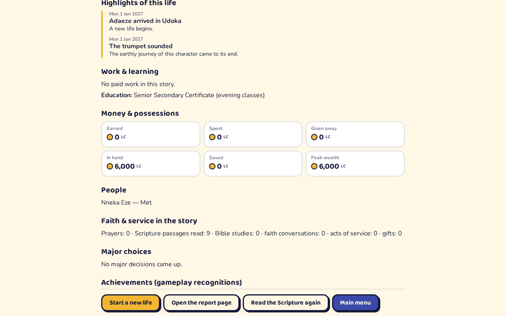

# Life for Jesus: The Journey

A browser-based 2D Christian life simulation. You create a character in **Udoka**, a fictional Nigerian city, and live an ordinary life — work, study, trade, save, buy things, make friends, help neighbours, pray, read Scripture and share your faith respectfully. Choices have consequences, some immediate and some delayed. Then, at a moment you are never told in advance, **the trumpet sounds**: the story ends with a life review, Scripture on accountability and grace, and a report of the simulated life.

| | |
|---|---|
|  |  |
|  |  |
|  |  |

> **About the scoring.** Life Coins, XP, crowns and badges are game mechanics that record what happened in the simulation. They are not salvation, they are not merit before God, and the game cannot see anyone’s heart. The game says so wherever it matters (crowns, prayer, ending, report).

---

## Stack

- **Client:** React 18 + Vite, Tailwind CSS 4, Phaser 3 (world, movement, collisions, animation), lucide icons, self-hosted fonts (Baloo 2, Nunito)
- **Server:** Node.js + Express, MongoDB via Mongoose, cookie-based JWT sessions, CSRF protection, Zod validation, Helmet, rate limiting, Pino logging
- **Shared package (`shared/`):** all game content (maps, items, jobs, NPCs, dialogue, missions, scenarios, achievements, Scripture references) and the deterministic simulation engine. The **server runs the engine authoritatively**; the client uses the same data for display.
- **Tests:** Vitest (engine, content governance, random-play fuzzing), Supertest (API against a real database), React Testing Library (UI), Playwright (full browser journey)
- JavaScript only (no TypeScript).

```
life-for-jesus/
├─ shared/     content + engine (pure JS, no I/O) — used by server and client
├─ server/     Express API, Mongoose models, Bible data, tests
├─ client/     React UI + Phaser world, UI tests, Playwright e2e
├─ scripts/    build-bible.mjs (fetches the public-domain World English Bible)
└─ docs/       API, content governance, asset licences, features, screenshots
```

---

## Quick start (local)

**Prerequisites:** Node.js 20+ (22 recommended) and a MongoDB server (6.0+). Any of:
- `docker compose up -d` (uses the included `docker-compose.yml`, MongoDB 7 on port 27017)
- a local `mongod`
- a free MongoDB Atlas cluster (put its connection string in `MONGO_URL`)

```bash
npm install                      # installs all three workspaces
cp server/.env.example server/.env   # then edit if needed (see below)
npm run dev                      # API on http://localhost:4000, game on http://localhost:5173
```

Open **http://localhost:5173**, choose **Play as guest** (or create an account), and start a new life.

Optional demo account: `npm run seed` creates `demo@lifeforjesus.local` / `demo-password-123` with one character.

### Production-style run (single server)

```bash
npm run build      # builds client/dist
npm start          # Express serves the API and the built game on http://localhost:4000
```

### Bible text

`server/data/web-bible.json` (the full **World English Bible**, public domain, 31,103 verses) is included. To rebuild it from source: `npm run bible:build` (downloads from github.com/TehShrike/world-english-bible). To use a different translation, produce a file in the same shape and point `BIBLE_DATA_FILE` at it — check that its licence permits your distribution.

---

## Environment variables (`server/.env`)

| Variable | Default | Purpose |
|---|---|---|
| `NODE_ENV` | `development` | `production` disables dev tools, enables secure cookies, and **requires** a strong `JWT_SECRET` |
| `PORT` | `4000` | HTTP port |
| `MONGO_URL` | `mongodb://127.0.0.1:27017/lifeforjesus` | MongoDB connection string |
| `JWT_SECRET` | dev placeholder | Session signing key — set a long random value in production (`node -e "console.log(require('crypto').randomBytes(48).toString('hex'))"`) |
| `CORS_ORIGIN` | – | Comma-separated origins, only needed when the client is hosted on a different domain |
| `COOKIE_SECURE` | `true` in production | Send cookies only over HTTPS |
| `COOKIE_SAMESITE` | `lax` | Use `none` (with `COOKIE_SECURE=true`) only for cross-site hosting |
| `DEV_TOOLS` | `true` | Development tools (trumpet trigger, time skip, save inspector). **Never mounted when `NODE_ENV=production`.** |
| `SERVE_CLIENT` | `true` | Serve `client/dist` from Express |
| `BIBLE_DATA_FILE` | `data/web-bible.json` | Bible data file (relative to `server/`) |
| `LOG_LEVEL` | `info` | Pino log level |

Client (optional, build-time): `VITE_API_BASE` — API origin if the client is hosted separately (default: same origin). `VITE_API_PROXY` — dev proxy target (default `http://localhost:4000`).

No secrets are ever shipped to the browser.

---

## Database

Collections (Mongoose models in `server/src/models/index.js`):

| Model | Holds |
|---|---|
| `User` | email (unique, optional for guests), bcrypt password hash, display name, guest flag |
| `Character` | the authoritative save: bounded `state` document, `rev` (optimistic concurrency), server-only `secret` and `endAtMinutes` (never selected by default, never sent to clients), summary for listings |
| `ActionRecord` | idempotency key + audit of every authoritative action (unique on character + key), ledger of coin changes |
| `LifeEvent` | the unbounded life history used for the review and report |
| `JournalEntry` | private prayer-journal reflections |
| `PlayerSettings` | audio and accessibility settings per user |
| `ScriptureFavorite` | saved passages per user |

Indexes are created on startup. No seeding is required — static content (maps, items, missions, dialogue…) is versioned code in `shared/content`, reviewed like code, and identical on server and client. `npm run seed` only creates the optional demo account.

**Integrity without multi-document transactions:** every action is reserved by inserting an `ActionRecord` with a unique `(characterId, key)` (so duplicates can’t run twice), then applied with a compare-and-set on `Character.rev` (so concurrent writes can’t interleave). Coins can never go negative, inventory is bounded, one-time rewards are recorded in the save and checked by the engine. This works on standalone MongoDB as well as replica sets.

---

## How to play

**Controls:** `WASD`/arrows walk · `E` or `Space` interact · `I` inventory · `M` map & travel · `J` missions · `P` pray · `B` Bible · `K` work & study · `R` people · `C` profile · `Esc` pause/close. On phones and tablets use the on-screen pad and the round action button (or force them on in Settings).

- Walk into a building’s door to go inside. A gold outline shows what you can use; the prompt at the bottom says what it does.
- **Money:** get a job from a vacancies board (Brightwell office, Grace Chapel) or the Work & study panel, study at the Learning Centre registrar, start a business (market stall, tailoring, keke, farm), shop at Oja Market, Mama Ngozi’s and Udoka Motors, save at the Cooperative Bank, buy property from the estate agent on Amaka Close. Bills are paid automatically each month; shortfalls become arrears, never negative coins.
- **Time:** one game minute passes per real second while you roam, and actions take time. Sleep at home, or **Live the next month** to fast-forward your routine — that’s how years pass. Closing the browser does not advance time.
- **People:** talk to Nneka, Chidi, Emeka, Aisha, Mama Ngozi, Pastor Tunde, Brother Sam, Mallam Ibrahim, Dr Amina, Uncle Obi and Nne Adaeze (Nkwo), and on Friday/Saturday evenings the fictional singer Tobi Vibes. Stories unfold over days; listening, helping and respecting boundaries matter. Pushing people damages trust.
- **Faith:** pray at your prayer corner, Grace Chapel, the garden bench, the village church or the riverside in Philippi (with an optional private journal); read or search the whole Bible; join Bible study; volunteer at the food bank or homework club; give.
- **Decisions** pop up as life unfolds (a falsified report, a heavy scale, family school fees, betting, mockery in class, a threatening note, a promise vs a concert, cheap adulterated stock, a windfall). Some have delayed consequences.
- **Travel:** the motor park takes you to Nkwo village (borehole project, farmland). The map’s **Eras** tab opens the Philippi historical scenario (level 2+); your own timeline is paused there.
- **Modes:** *Mission Mode* keeps the next two missions of a 15-mission journey active; *Free Life* leaves everything optional (notice boards, NPC requests).
- **The ending:** with “Unexpected trumpet” (or “Short journey”), the end comes at a hidden moment chosen by the server. An ended character can’t be continued; their report remains and other characters are untouched. “Open sandbox” has no ending.

---

## Testing

```bash
npm test                 # shared engine + server API + client UI (API tests need MongoDB running)
npm run test:e2e         # Playwright: builds the client, starts the server, plays a full journey
```

- `shared`: 60 tests — engine rules (movement, time, ageing, economy, inventory limits, missions, scenarios, delayed consequences, history, ending scheduler, reports), content governance (every Scripture reference exists in the Bible data, dialogue graph integrity, walkable maps, reachable interactables), and random-play fuzzing (2,400 random actions with invariants).
- `server`: 20 tests with Supertest against a real database — auth & CSRF, guest upgrade, ownership isolation, idempotent and concurrent duplicate actions, invalid currency, ignored client-submitted rewards, validation and body limits, journal privacy, dev ending + report, Scripture, favourites, settings. Set `MONGO_URL_TEST` to use a specific database (each run creates and drops its own).
- `client`: 11 React Testing Library tests — character creation, menus, guest play, server-unreachable recovery, settings persistence, dialogue, inventory, missions, decisions, error handling.
- `client/e2e`: Playwright journey — open the app, play as guest, create a character, walk in four directions, talk to an NPC, get a job and work a shift, walk to the market and buy food, eat, walk home and sleep (mission complete), pray with a journal entry, search Scripture, save and reload, trigger the ending, go through the review to the report, start a new character and see both lives. Plus a mobile touch-controls test.
  - If Playwright can’t download its browser, set `CHROMIUM_PATH=/path/to/chromium`.
  - Tests load the world with `?renderer=canvas` because software-rendered CI browsers run WebGL slowly. You can use the same flag on devices with a weak or blocklisted GPU.

**Results of the last run (in the build environment):** shared 60/60, server 20/20, client 11/11, e2e 2/2 passed (+1 skipped screenshot job). The API and e2e runs used **FerretDB 1.24** (a MongoDB-wire-compatible server) because a MongoDB binary could not be downloaded in that sandbox; the code avoids features FerretDB lacks and targets MongoDB 6+.

---

## Development tools

With `DEV_TOOLS=true` (and never in production), the pause menu shows a developer box: current map/position/minute, active missions and dialogue, **Advance 6 hours**, **Inspect save** (including the hidden ending time) and **Trigger the trumpet**. The same functions are at `/api/dev/...`. They are not rewards and are not reachable in production builds of the server. The browser console logs every action and its events in dev builds.

---

## Deployment

**Simplest — one service:** build the client and run the server; Express serves both.
1. Create a MongoDB Atlas cluster (or any managed MongoDB) and copy the connection string.
2. On Render, Railway, Fly.io, a VPS, etc.: build command `npm ci && npm run build`, start command `npm start`, Node 20+.
3. Set `NODE_ENV=production`, `MONGO_URL`, a strong `JWT_SECRET`, and serve over HTTPS (cookies are `Secure` in production). `DEV_TOOLS` is ignored in production.
4. Health check: `GET /api/health`.

**Split hosting** (static client on Netlify/Vercel/Cloudflare Pages + API elsewhere): build the client with `VITE_API_BASE=https://your-api.example.com`, set `CORS_ORIGIN=https://your-game.example.com`, `COOKIE_SAMESITE=none`, `COOKIE_SECURE=true`, `SERVE_CLIENT=false` on the API, and configure the static host to rewrite all routes to `index.html`. Same-site hosting (e.g. `game.example.com` + `api.example.com`) works with `lax`.

Assets are all generated in code or bundled (no remote asset dependencies). The Bible data (4 MB JSON) is loaded once into server memory.

---

## Further documentation

- [docs/API.md](docs/API.md) — every endpoint
- [docs/CONTENT_GOVERNANCE.md](docs/CONTENT_GOVERNANCE.md) — Scripture handling, theological choices, fictional vs historical content
- [docs/ASSETS.md](docs/ASSETS.md) — asset and licence inventory
- [docs/FEATURES.md](docs/FEATURES.md) — implemented features, known limitations, deferred work
